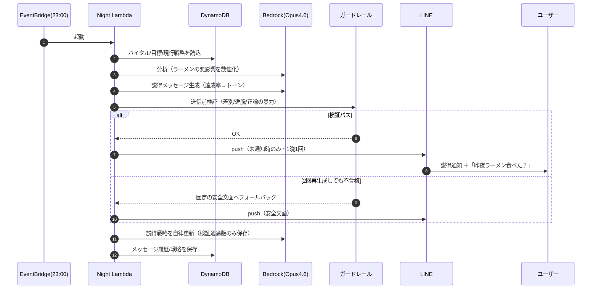
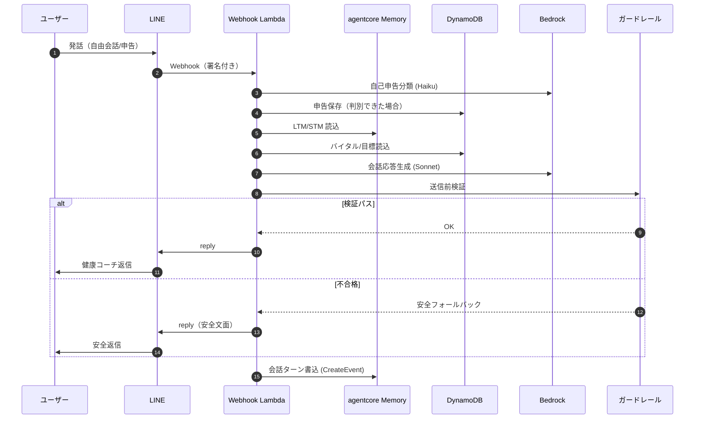

# Night Ramen Breakdown — 構成フロー図

深夜のラーメン断ち自律改善ループシステムの全体構成（Feature 001 夜間ループ ＋ Feature 002 LINE 対話）。
編集可能な図版は [`architecture.drawio`](architecture.drawio) を参照。

> 最終更新: 2026-06-15

## フロー概要

- **朝（①②）** … Google Health からバイタル収集、自己申告と紐づけ
- **夜（③〜⑥）** … 分析・説得生成 → ガードレール → LINE push（23 時 1 回）
- **会話（⑦〜⑫）** … LINE 発話 → Webhook → 会話応答 → ガードレール → reply 返信

```mermaid
flowchart TB
    user["👤 ユーザー（LINEアプリ）"]
    ghealth["🩺 Google Health API（Fitbit）<br/>睡眠(総時間含) / HRV / 歩数 / カロリー"]

    subgraph AWS["AWS us-east-1 — NightRamenStack（CDK / NRB_ENV=prod）"]
        ebM["⏰ EventBridge<br/>朝 08:00 JST"]
        ebN["⏰ EventBridge<br/>夜 23:00 JST"]
        lM["λ Morning Lambda<br/>バイタル収集 ＋ 自己申告紐づけ"]
        lN["λ Night Lambda<br/>分析→目標評価→生成→検証→push→学習"]
        lW["λ Webhook Lambda<br/>署名検証→会話応答→ガードレール→返信<br/>＋申告保存→Memory書込"]
        url["🌐 Lambda Function URL（LINE Webhook HTTPS）"]
        gr["🛡 ガードレール<br/>正規表現(稼働) + LLM(未配線)<br/>fail-closed・最大2回再生成"]
        mem["🧠 agentcore Memory<br/>LTM + STM(直近6ターン)"]
        ddb[("🗄 DynamoDB NightRamenTable<br/>バイタル / 目標 / 申告 / 冪等（1年TTL）")]
        bed["🤖 Amazon Bedrock (prod)<br/>夜=Opus4.6 / 会話=Sonnet4.6 / 分類=Haiku4.5"]
        sec["🔐 Secrets Manager<br/>Google OAuth / LINE（署名検証鍵込み）"]
    end

    %% 朝フロー
    ebM -->|起動| lM
    lM -->|① 前夜バイタル取得| ghealth
    lM -->|② 収集保存 ＋ 申告読込| ddb
    lM -.->|トークン参照| sec

    %% 夜フロー
    ebN -->|起動| lN
    lN -->|③ バイタル/目標を読込| ddb
    lN -->|④ 分析・説得生成 (Opus4.6)| bed
    lN -->|⑤ 送信前検証| gr
    gr -->|⑥ 説得通知（push・23時1回）| user
    lN -.->|モデル/トークン| sec

    %% 会話フロー (Feature 002)
    user -->|⑦ LINE発話（会話/申告）| url
    url --> lW
    lW -->|⑧ 申告保存（固定+Haiku分類）| ddb
    lW -->|⑨ 文脈読込/書込| mem
    lW -->|⑩ 会話(Sonnet) / 分類(Haiku)| bed
    lW -->|⑪ 送信前検証| gr
    lW -->|⑫ 返信 (reply)| user
    lW -.->|バイタル/目標参照| ddb
    lW -.->|署名検証鍵| sec

    classDef ext fill:#E8F0FE,stroke:#4285F4,color:#111;
    classDef lambda fill:#FFF4E5,stroke:#FF9900,color:#111;
    classDef data fill:#E8EAF6,stroke:#3F51B5,color:#111;
    classDef sched fill:#FCE8E6,stroke:#E8453C,color:#111;
    classDef ai fill:#E6F4EA,stroke:#34A853,color:#111;
    classDef guard fill:#FDECEA,stroke:#C0392B,color:#111;
    classDef secret fill:#FCE8E6,stroke:#D93025,color:#111;
    classDef line fill:#06C755,stroke:#04994A,color:#fff;
    classDef memory fill:#E3F2FD,stroke:#1565C0,color:#111;

    class ghealth ext;
    class user line;
    class lM,lN,lW,url lambda;
    class ddb data;
    class ebM,ebN sched;
    class bed ai;
    class gr guard;
    class sec secret;
    class mem memory;
```

## 凡例

- **実線** … データ/処理のフロー（①〜⑫）
- **破線** … Secrets Manager 参照、または DynamoDB 読込
- **応答時間（実測）** … ウォーム約 6 秒 / コールド約 13 秒
- **LINE OA 設定** … 応答モード=Bot、応答メッセージ=オフ、Webhook=オン

## シーケンス（夜の説得 1サイクル）



## シーケンス（LINE 会話 1ターン — Feature 002）


