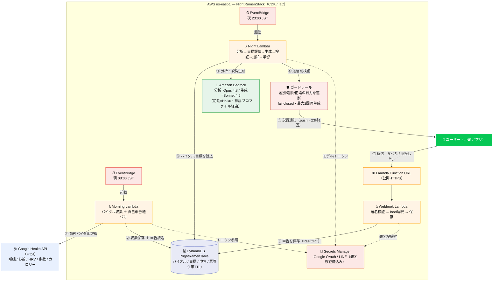

# Night Ramen Breakdown — 構成フロー図

深夜のラーメン断ち自律改善ループシステムの全体構成。
朝（①②）で収集、夜（③④⑤⑥）で説得通知、自己申告（⑦⑧）でループが閉じる。

## 凡例

- **実線** … データ/処理のフロー（①〜⑧の順）
- **破線** … Secrets Manager からの認証情報・鍵の参照
- **朝 08:00 JST** … Google Health から前夜バイタルを収集し、自己申告と紐づけて DynamoDB へ
- **夜 23:00 JST** … 蓄積データを Bedrock で分析・説得生成 → ガードレール検証 → LINE へ1回通知
- **自己申告** … ユーザーの LINE 返信を Webhook（署名検証付き）で受け、DynamoDB に記録 → 翌朝の収集が紐づけ

## シーケンス（夜の説得 1サイクル）

