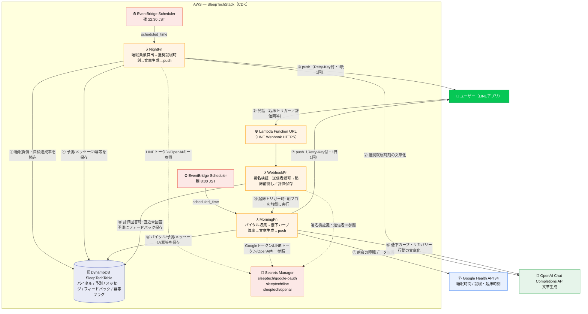
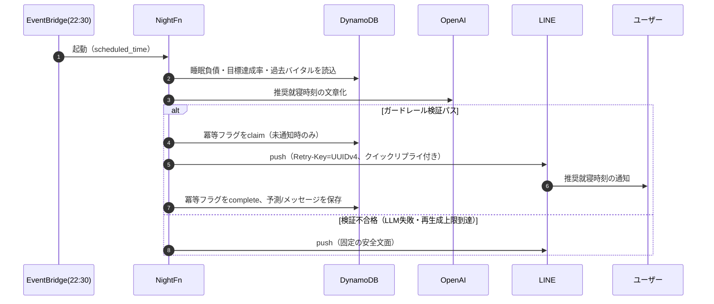
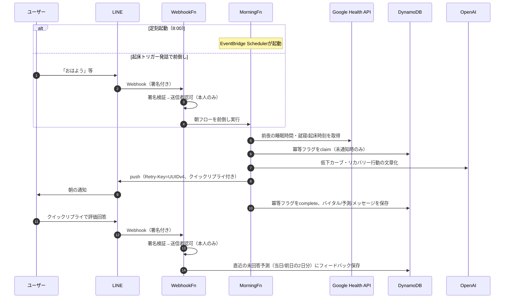

# SleepTech ver1.0 — 構成フロー図

睡眠データから翌日のパフォーマンス低下を予測し、LINE で1日2回アドバイスするシステムの全体構成。

> 最終更新: 2026-08-26

## フロー概要

- **夜フロー（22:30 JST）** … 直近の睡眠負債・目標達成率から推奨就寝時刻を算出し、LLMで文章化してLINE push
- **朝フロー（8:00 JST、または「おはよう」等の発話で前倒し）** … 前夜の睡眠データをGoogle Health APIから収集し、時間帯別パフォーマンス低下カーブとリカバリー行動をLLMで文章化してLINE push
- **Webhook（常時）** … LINE署名検証 → 送信者認可（本人のみ）→ 起床トリガー検出時は朝フローを前倒し実行、クイックリプライ評価は直近の未回答予測にフィードバックとして保存

## 凡例

- **実線** … データ/処理のフロー（①〜⑪）
- **破線** … Secrets Manager 参照
- **冪等制御** … `retry_key`（UUID v4形状。LINE `X-Line-Retry-Key`）＋ DynamoDB `IDEM#NIGHT` / `IDEM#MORNING`（`claim`→`complete`の2段階ロック）で二重送信を防ぐ
- **起点日の扱い** … 夜フローは当日、朝フローは前日を起点日とする（前夜の夜メッセージと同じ日付に揃えるため）。`scheduled_time`（EventBridge Schedulerが渡すISO時刻）を優先し、壁時計時刻はフォールバック

## シーケンス（夜フロー 1サイクル）

## シーケンス（朝フロー／Webhook起床前倒しを含む）

